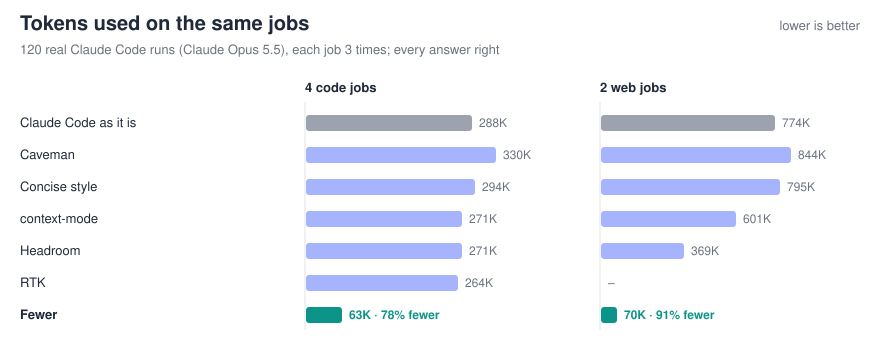
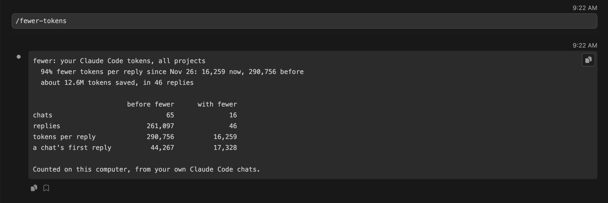

<p align="center">
  <picture>
    <source media="(prefers-color-scheme: dark)" srcset="assets/logo-dark.svg">
    
  </picture>
</p>

<h3 align="center">Fewer tokens. Nothing forgotten.</h3>

<p align="center">
  <b>Get your Claude usage back: 87% fewer tokens, the same answers.</b><br>
  Claude reads short versions. The full text stays on your computer.
</p>

<p align="center">
  <a href="LICENSE"></a>
  
</p>

<p align="center">
  <a href="#what-is-fewer">What is it</a> ·
  <a href="#benchmark">Benchmark</a> ·
  <a href="#see-it">See it</a> ·
  <a href="#install">Install</a> ·
  <a href="#use">Use</a>
</p>

---

## What is Fewer?

Fewer makes Claude Code use **87% fewer tokens**, so your Claude usage lasts longer and costs
less. It's free.

At every step, Claude Code re-reads the whole chat: whole files, full test results, long logs.
Fewer gives it short versions instead, like only the failed tests. The full text stays on your
computer, with passwords and API keys hidden.

You get the same answers as with Claude Code alone, and everything else works as usual: rewind,
your permissions, your add-ons.

## Benchmark

<p align="center">
  <picture>
    <source media="(prefers-color-scheme: dark)" srcset="assets/benchmark-dark.svg">
    
  </picture>
</p>

Same tasks in a fresh Claude Code (2.1.332, Claude Opus 5.5), 3 runs with each tool. Every answer
was right, with Fewer and without it. Your own savings depend on how long your chats are.

**Rerun it yourself:** the benchmark is in [bench/](bench/README.md), one command on your own
computer.

### Each task, before and after

| Task | Claude Code alone | With Fewer | Fewer tokens |
|---|--:|--:|--:|
| Find why the tests fail | 49,341 | 15,676 | **68%** |
| Count the errors in a log | 96,422 | 16,432 | **83%** |
| Add up the totals in a CSV file | 70,935 | 15,679 | **78%** |
| Explain the last commit | 70,927 | 15,457 | **78%** |
| Find two status codes in a web page | 686,843 | 35,097 | **95%** |
| A web search: when Rust 1.0 came out | 86,941 | 34,862 | **60%** |
| Fix a bug, then run its test | 98,245 | 37,813 | **62%** |
| Read 13 files and answer 5 questions | 82,611 | 32,046 | **61%** |
| Review 20 files one by one (a long chat) | 657,844 | 43,561 | **93%** |
| **All 9 tasks** | **1,900,109** | **246,623** | **87%** |

## See it

`/fewer-tokens` in a Claude Code chat, on the author's computer:

<p align="center">
  
</p>

## Install

Works on macOS, Linux and Windows. All you need is [Claude Code](https://claude.com/claude-code).

```sh
curl -fsSL https://github.com/hazemdawahi/fewer/releases/latest/download/install.sh | sh
```

On Windows, in PowerShell:

```powershell
irm https://github.com/hazemdawahi/fewer/releases/latest/download/install.ps1 | iex
```

It shows every change it will make, then asks you once. Then open a new Claude Code chat.

Or paste this into Claude Code:

```text
Install Fewer for me: curl -fsSL https://github.com/hazemdawahi/fewer/releases/latest/download/install.sh | sh -s -- --yes
```

**Update:** `fewer update` &nbsp;·&nbsp; **Remove:** `fewer uninstall`

## Use

Use Claude Code as usual: it uses Fewer by itself. These are for you:

| Command | What it does |
|---|---|
| `fewer tokens` | The tokens Fewer saved |
| `fewer memory` | What Fewer saved, its size, and delete what you want |
| `fewer off` / `fewer on` | Turn Fewer off or on |

In a Claude Code chat: `/fewer-tokens`, `/fewer-memory`, `/fewer-off`, `/fewer-on`.

## License

Apache 2.0. See [LICENSE](LICENSE).

---

<p align="center">
  <picture>
    <source media="(prefers-color-scheme: dark)" srcset="assets/logo-dark.svg">
    
  </picture>
</p>

<p align="center"><b>Get your Claude usage back.</b> Star it if you like it.</p>
